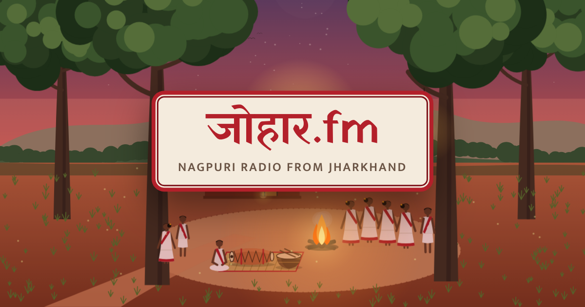

# johar.fm

**Nagpuri radio from Jharkhand.** The header wordmark is written **जोहार.fm**.

A radio that never stops, set in one illustrated scene: a village akhra at dusk under sal trees, the
mandar and nagara resting on a mat, crickets, and the fire just lit. Turn the dial between four moods:
Love, Travel, Party and Relaxed. One tap and it plays.



- **Four moods on the dial**, each with its own illustration, playlist and village sounds:

  | Dial label | Internal id (`world` in playlists.json) | Scene |
  |---|---|---|
  | Love | `akhra` | Village akhra at dusk under sal trees |
  | Travel | `trekker` | Overloaded trekker on a ghat road |
  | Party | `biha` | Wedding courtyard with the madwa |
  | Relaxed | `parab` | Festival akhra (Karam, Sarhul, Jitiya, Fagua props) |
- **Follows your clock.** Morning, afternoon, dusk and night each have their own look; lanterns and the
  fire glow after dark. During a festival the Relaxed (`parab`) station lights up.
- **Village sounds** (crickets, wind in the sal, a distant mandar, the trekker's engine and horn) are
  synthesised in the browser. No sound files.
- **Songs play from YouTube** using official uploads. Nothing is downloaded or re-hosted.
- No login, no cookies of our own, no analytics. Lighthouse mobile: 100 / 100 / 100 / 100.

Live at **https://mandar.fm.vercel.app**. Design and behaviour are specified in [SPEC.md](SPEC.md).

---

## Run it

Requires Node 20+.

```sh
npm install
npm run dev          # http://localhost:5173
```

Useful URL overrides while developing:

| Override | Example | Effect |
|---|---|---|
| `?phase=` | `?phase=night` | Force morning / afternoon / dusk / night |
| `?date=` | `?date=2026-09-02` | Pretend it's this date (to test festival highlighting) |
| `?world=` | `?world=trekker` | Start on a world |

Dev-only pages (not shipped):

- `/dev/scene.html?world=parab&phase=night&festival=sarhul`: a single scene, for drawing.
- `/dev/ambience-balance.html`: renders each ambience layer offline and prints its loudness. Use it to
  set `TRIM` in `src/ambience/layers.ts` after changing a sound.

## Adding songs

Songs live in [`src/data/playlists.json`](src/data/playlists.json):

```json
{
  "world": "trekker",
  "title": "Pokhara Ke Pire Guiya",
  "artist": "Pawan Roy, Pankaj Roy, Monika Mundu",
  "youtubeId": "",
  "startAt": 12,
  "notes": "2016"
}
```

| Field | |
|---|---|
| `world` | `akhra` (Love), `trekker` (Travel), `biha` (Party) or `parab` (Relaxed) |
| `title`, `artist` | Shown in the radio and on the lock screen |
| `youtubeId` | The 11-character ID from `youtube.com/watch?v=…`. Leave `""` for a placeholder. |
| `startAt` | Optional. Seconds to skip (long intros). |
| `notes` | Optional. For you; not shown. |
| `festival` | Optional, `parab` (Relaxed) only: `karam`, `sarhul`, `jitiya` or `fagua`. These songs come up 3× as often during that festival. |
| `titleMatch` | Optional. Part of the real YouTube title, if the verifier can't match your `title` (see below). |

Rules:

1. **Use the official upload**, from the artist's or label's channel, wherever one exists.
2. **Never guess an ID.** Copy it from the video page, then run `npm run verify`.
3. The seed file has empty placeholders for Mukund Nayak, Mahavir Nayak, Govind Sharan Lohra,
   Madhu Mansuri Hasmukh, Monika Mundu, Pawan Roy, Pankaj Roy, Nitesh Kachhap, Kumar Pritam and
   Ignes Kumari. Replace each `TODO` with a real song.

Artist channel links go in [`src/data/artists.json`](src/data/artists.json). `npm run verify` checks
any filled-in `channelUrl`. They aren't shown on the site at the moment (the page is a single screen
with no footer).

### Verify playlists

```sh
npm run verify
```

This looks up every ID through YouTube's oEmbed endpoint and prints your title next to YouTube's:

```
STATUS    WORLD    YOUR TITLE                     YOUR ARTIST              YOUTUBE TITLE                 YOUTUBE CHANNEL
OK        trekker  Pokhara Ke Pire Guiya          Pawan Roy, Pankaj Roy, … POKHARA KE PIRE GUIYA | …     …
PENDING   akhra    TODO                           Mukund Nayak
```

It **fails** (and so does the build) when:

- an ID is dead, private or not embeddable (`DEAD`);
- YouTube's title doesn't match yours (`MISMATCH`). Matching ignores case, punctuation, words like
  "official video", years, and one-letter spelling differences ("Pokhra" / "Pokhara"). If a correct
  video still fails, set `titleMatch` to a phrase from its real title;
- YouTube can't be reached (`NETWORK`);
- an ID is malformed or duplicated, or a world/festival name is unknown;
- `festivals.json` is invalid;
- a world has no playable songs.

Placeholders with an empty ID are listed as `PENDING` and don't fail anything.

Escape hatches for local work:

```sh
ALLOW_EMPTY_WORLDS=1 npm run verify     # allow worlds with no songs yet
VERIFY_OFFLINE=warn npm run verify      # warn instead of failing when offline
```

## Festival dates

Festival dates are lunar and change every year, so they're entered by hand in
[`src/data/festivals.json`](src/data/festivals.json) instead of computed. It ships empty. Add each
year's dates from a calendar you trust:

```json
[
  { "id": "karam", "year": 2027, "start": "YYYY-MM-DD" },
  { "id": "fagua", "year": 2027, "start": "YYYY-MM-DD", "end": "YYYY-MM-DD", "leadDays": 3 }
]
```

The Relaxed (`parab`) station starts glowing `leadDays` (default 7) before `start` and stops `trailDays`
(default 2) after `end`. First-time visitors land on it during that window; returning visitors keep
their last station and see the glow and a greeting. Test with `?date=YYYY-MM-DD`.

## Copy

All user-facing text is in [`src/i18n/strings.ts`](src/i18n/strings.ts), in English. Devanagari
appears in only two places: जोहार in the जोहार.fm wordmark (`index.html`), and a small Nagpuri word under
each dial label (`nag` in the strings file: माया, डहर, नाच, जुड़ाव). Those four are drafts marked
`// VERIFY`; a test fails if a marker goes missing. Once a native speaker has checked them, remove the
markers and set `NAG_REVIEWED = true`. They're hidden on short screens.

## Test and build

```sh
npm test             # unit tests (time of day and festivals with a mocked clock, shuffle, storage, …)
npm run build        # verify playlists → typecheck → tests → vite build, into dist/
npm run preview      # serve dist/
```

`npm run build` is strict: it fails until every world has at least one verified song. To build
the scaffold before that: `ALLOW_EMPTY_WORLDS=1 npm run build`.

### Share image and icons

`public/og.png` (1200×630) and the app icons are rendered from the live Akhra scene with headless
Chrome, then committed. Re-run after changing the default scene:

```sh
npm run og           # set CHROME_PATH if Chrome isn't in the usual place
```

## Deploy (Vercel)

1. Push this repo to GitHub and import it at [vercel.com/new](https://vercel.com/new). `vercel.json`
   already sets the framework (Vite), `npm run build` and `dist/`.
2. After the first deploy, check the URL Vercel actually assigns. The site is configured for
   `https://mandar.fm.vercel.app`, but Vercel may turn the dot into a dash (`mandar-fm.vercel.app`).
   If it differs, or you add a custom domain, change `SITE_URL` in
   [`src/content/site.ts`](src/content/site.ts) (canonical, sitemap and share tags all read it) and redeploy.
3. Deploy. The build fetches YouTube oEmbed to verify playlists, which Vercel's build machines can do.

Or from the CLI:

```sh
npx vercel --prod
```

## Known limitations

- **The YouTube player is hidden behind the scene.** YouTube's embed policies expect the player to be
  visible, so this carries a risk of embeds being restricted. If a browser blocks programmatic
  playback (common on iOS), the player is shown for a moment so the listener can tap it, then hides again.
- **Lock screen and background play.** Title and artist appear on the lock screen and headset buttons
  work where the browser allows. Many mobile browsers pause a YouTube iframe when the screen locks or
  the tab is in the background, and a website can't override that.
- **Fonts.** Devanagari uses the device's own fonts, so it looks slightly different on Android, iOS and
  Windows.

## Project layout

```
src/
  app.ts               player controller: queue, YouTube, watchdog, ambience, prefs
  main.ts              boot: clock, festival, first-visit logic, wiring
  data/                playlists.json, artists.json, festivals.json, worlds
  i18n/strings.ts      all copy (English)
  time/                dayPhase.ts, festival.ts (pure, unit-tested)
  player/              youtube.ts, queue.ts (shuffle bag), mediaSession.ts
  ambience/            Web Audio engine, synthesised layers, per-world recipes
  scene/               layered SVG scenes drawn in code, palettes, animations
  ui/                  radio dial and controls, keyboard
build/                 Vite plugin: inlines scene/i18n/SEO/footer, renders CREDITS.md, sitemap
scripts/               verify-playlists.ts, render-images.ts
dev/                   scene preview, OG card, ambience loudness harness
tests/                 Vitest
```

The page is exactly one screen: no footer, no scrolling. Below the radio is a single line with
"Made with love from Jharkhand", Credits and Suggest a song.

Keyboard: `Space` play/pause · `→` next · `←` restart · `↑`/`↓` volume · `1`–`4` worlds · `A` village
sounds · `M` mute.

## Credits

See [CREDITS.md](CREDITS.md) or [/credits](https://mandar.fm.vercel.app/credits/). Suggest a song with
the [issue form](https://github.com/vinitshahdeo/mandar.fm/issues/new?template=suggest-a-song.yml).

## Listing in awesome-saloon-wtf

For a PR to [chetanraj/awesome-saloon-wtf](https://github.com/chetanraj/awesome-saloon-wtf), under
**🌏 Regional → Bhojpuri / East**:

```markdown
- [johar.fm](https://mandar.fm.vercel.app/) - Nagpuri radio from Jharkhand: love, travel, party and relaxed moods at a village akhra under sal trees (Vinit Shahdeo).
```

---

Made with love from Jharkhand.
